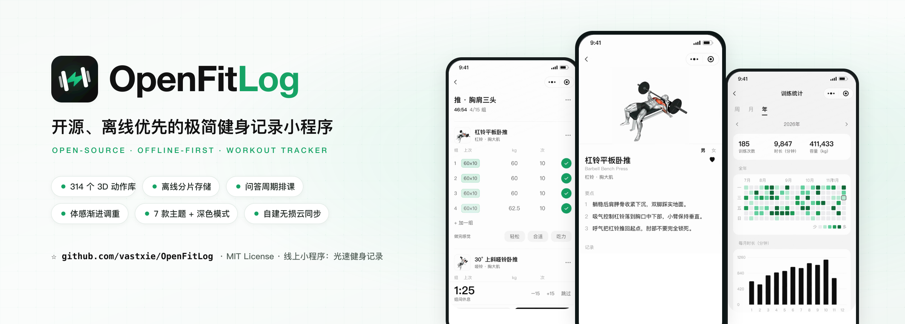

# OpenFitLog

**An open-source, offline-first minimalist workout & stretching tracker built as a native WeChat Mini Program.**

Zero third-party frontend dependencies. Data is stored locally first with zero network latency, sharded monthly to bypass WeChat's 1MB per-key storage limit. Ships with a 314-exercise library (with dual male/female 3D anatomy demonstrations, form cues, and safety notes), a wizard-based weekly routine generator, RPE-based progressive overload suggestions, CSV export, and an optional zero-dependency Node.js cloud sync server.

[简体中文](./README.md) · English

[Demo Video](#demo-video) · [Highlights](#highlights) · [Quick Start](#quick-start) · [Self-Hosting](#self-hosting-media--sync) · [Community](#live-mini-program--community)

## Demo Video

https://github.com/user-attachments/assets/338eb490-76bd-4912-a60b-b5579096d6a4

34-second walkthrough covering smart plan generation, one-handed set logging & rest timers, 314 3D exercise demos, annual workout heatmaps, and 7 light/dark themes.

## Highlights

- **Offline-First Sharded Storage** — Instant local reads/writes with zero backend required. Workout logs are sharded by month (`fitlog_v3_w_YYYY-MM`) to avoid WeChat's 1MB single-key limit.
- **314-Exercise 3D Library** — Categorized across 11 body parts and equipment types with bilingual search, form cues, safety notes, and male/female 3D video demos (gracefully falls back to crisp integer-pixel muscle silhouette icons when offline or without external media).
- **Smart Weekly Planner & RPE Progression** — Generates weekly routines and estimated starting weights from a short questionnaire, then suggests incremental weight adjustments based on your previous session's RPE feedback (Easy / Good / Hard).
- **Gym-Ready One-Handed UX** — Built-in custom bottom numeric keypad (`components/num-pad`) with per-equipment step memory, cascading updates across remaining identical sets, automatic compound/isolation rest timers, and PR session summaries.
- **Insights & CSV Export** — Weekly/monthly/yearly heatmaps, muscle-group set breakdown, 12-session PR trend charts, weight/BMI tracking, and one-tap CSV export for Excel.
- **7 Themes + Native Dark Mode** — Ink, Emerald, Ocean Blue, Violet, Warm Orange, Rose, and Mauve, driven purely by CSS variables.
- **Optional Lossless Cloud Sync** — Includes a single-file, zero-dependency Node.js server (`server/index.js`) using tombstone-aware ID union merging across devices.

## Quick Start

```bash
git clone https://github.com/vastxie/OpenFitLog.git
cd OpenFitLog
```

1. Open **WeChat DevTools** → Import Project → select the `OpenFitLog` directory.
2. Pre-configured with `"appid": "touristappid"` and the public R2 3D media CDN — runs out of the box with zero registration or backend setup.

## Self-Hosting Media & Sync

All external endpoints live at the top of `utils/config.js`:

- **Download all 1,184 3D videos & posters (~632 MB)** to host on your own CDN/OSS:
  ```bash
  npm run download:media
  # Or download the archive directly: https://fit-media.lightai.io/fit-log-media.zip
  ```
- **Run the local media streaming & cloud sync server** (Node.js >= 18, zero npm packages required):
  ```bash
  # Local dev mode (works with WeChat DevTools touristappid)
  npm start

  # Production mode
  TOKEN_SECRET="$(openssl rand -hex 32)" WX_APP_ID="wx..." WX_APP_SECRET="..." PORT=8787 node server/index.js
  ```

## Live Mini Program & Community

Scan the left WeChat Mini Program code to try the official hosted version (**光速健身记录**), or scan the right WeChat QR code with note **99** to join the developer community group.


---

[MIT](./LICENSE) © 2026 vastxie
