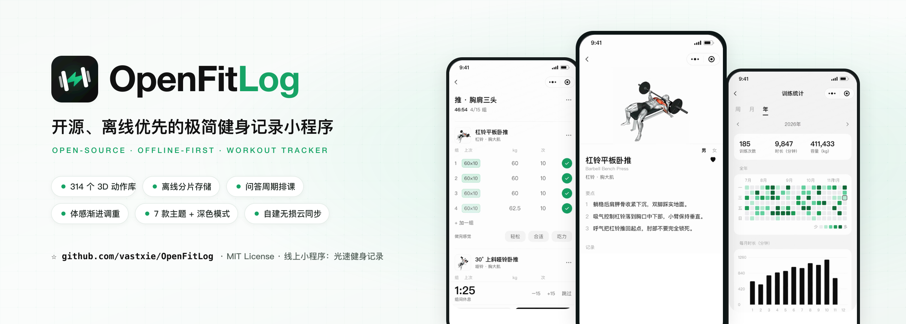
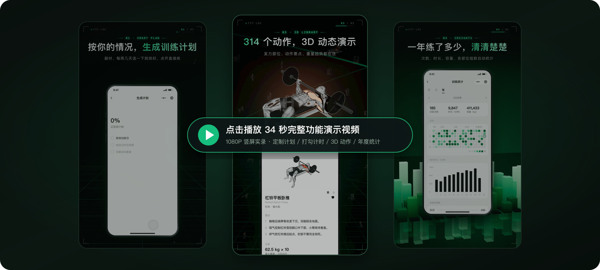
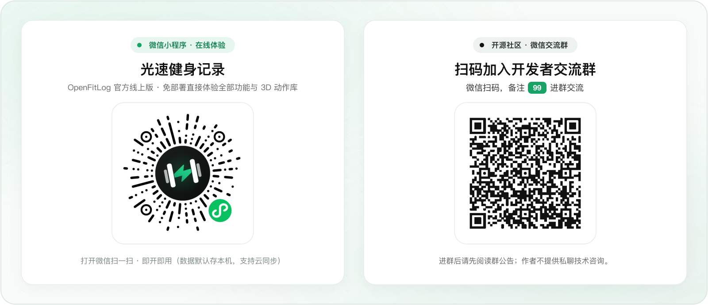

# OpenFitLog

**开源、离线优先的极简健身记录微信小程序。**

纯原生小程序构建（零第三方前端依赖），数据先存本机、读写不等网络。内置 314 个带男女双模 3D 动态演示的标准动作库、问答式周计划生成与体感渐进调重，支持一键导出 CSV 与私有化无损云同步。

简体中文 · [English](./README.en.md)

[演示视频](#演示视频) · [核心能力](#核心能力) · [快速开始](#快速开始) · [自建图床与云同步](#配置与自建指南) · [架构与定制](#架构与界面约定) · [在线体验与交流群](#在线体验与交流群)

## 演示视频

<!-- 创建 GitHub 公开仓库后，可在网页端编辑 README 并将 ./assets/readme/openfitlog-promo.mp4（8.8MB）直接拖入此处，即可替换为与 99AI 相同的 GitHub 原生内嵌视频播放器 -->
[](https://fit-media.lightai.io/promo/openfitlog-promo.mp4)

34 秒实机演示，涵盖定制训练计划、单手打勾与休息计时、314 个 3D 动作演示、年度统计热力图及 7 款深浅色主题。[在线高清播放](https://fit-media.lightai.io/promo/openfitlog-promo.mp4) · [下载视频](./assets/readme/openfitlog-promo.mp4)

## 核心能力

- **离线优先存储** — 默认无需任何后端，读写零等待；训练记录按月自动分片存储（`fitlog_v3_w_YYYY-MM`），彻底避开微信小程序单 key 1MB 容量上限。
- **314 个 3D 动作库** — 按 11 大部位与器械分组浏览、支持中英文与目标肌群搜索，整理了每个动作的发力要点与防伤提示，支持男女双模型 3D 视频切换；无图床或断网时自动优雅降级为整数像素肌肉部位剪影图标。
- **问答排课与渐进调重** — 按场地、器械条件、训练目标和每周天数自动生成周期计划并估算起始重量；训练中默认沿用上次完成数值，并根据上次标记的体感（轻松 / 适中 / 吃力）自动微调本次建议重量。
- **单手极简记录流** — 全自研防遮挡底部数字键盘（按杠铃、哑铃等器械独立记忆步长，修改一组自动联动后续未完成同值组）；每组打勾自动升起组间小休 / 换动作大休倒计时，结束自动弹出破纪录小结。
- **训练热力图与自由导出** — 内置周 / 月 / 年训练热力图、部位组数分布、单动作 PR 趋势折线与体重 BMI 曲线；支持一键导出 CSV，通过微信发送后直接用 Excel 打开。
- **7 款主题与原生深色模式** — 墨黑、翡翠、海蓝、藤紫、暖橙、蔷薇、豆沙，纯 CSS 变量驱动，跟随系统深浅色无缝切换。
- **可私有化无损云同步** — 附带零依赖单文件 Node.js 服务端（`server/index.js`），采用「删除墓碑 + 唯一 ID 并集」合并算法，离线修改后联网自动补传，换机不丢记录。

## 快速开始

```bash
git clone https://github.com/vastxie/OpenFitLog.git
cd OpenFitLog
```

1. 打开 **微信开发者工具** → 导入项目 → 选择 `OpenFitLog` 目录。
2. 项目默认已配置 `"appid": "touristappid"`（游客模式）与公共免流量 3D 动作媒体源，无需注册小程序或启动后端，导入即可直接编译体验完整功能与 3D 动作视频。

> 如需真机预览或正式发布上线你自己的小程序，请在微信开发者工具中替换为你的 AppID，并参考下方指南配置你自己的已备案域名。

## 配置与自建指南

所有外部地址与主体信息集中在 `utils/config.js` 顶部：

| 配置项 | 默认值 | 说明 |
| --- | --- | --- |
| `APP_NAME` | `'OpenFitLog'` | 分享卡片标题、CSV 导出文件名前缀、隐私页标题（导航栏标题同步改 `app.json`） |
| `MEDIA_BASE_URL` | `'https://fit-media.lightai.io'` | 动作演示海报与视频根地址；设为 `''` 时自动显示内置肌肉剪影图标并收起视频区 |
| `API_BASE_URL` | `''` | 云同步后端根地址；留空时运行在纯离线模式，自动隐藏「云同步」入口与同步引导弹窗 |
| `KF_URL` / `KF_CORP_ID` | `''` | 企业微信客服链接与企业 ID；留空时使用微信小程序原生 `open-type="contact"` 客服按钮 |
| `PRIVACY_OPERATOR` / `PRIVACY_EMAIL` | `''` | 隐私政策页展示的运营主体与联系邮箱（正式上架前请按实际主体填写，并同步更新小程序后台《用户隐私保护指引》） |

### 1. 拉取全套 3D 动作媒体素材自建图床（可选）

微信小程序正式发布要求媒体域名已在小程序后台配置（国内主体需 ICP 备案域名）。你可以通过以下任一方式获取全套 **1,184 个动作海报与 3D 视频（约 632 MB）**：

```bash
# 方式 A：命令行自动并发拉取至本地 media/ 目录（支持断点续传）
npm run download:media
```

- **方式 B（整包直链下载）**：[https://fit-media.lightai.io/fit-log-media.zip](https://fit-media.lightai.io/fit-log-media.zip)，解压至项目根目录 `media/` 下。

拉取完成后：
- **本地离线预览**：执行 `npm start` 启动内置静态流媒体服务（支持 HTTP 206 Range），将 `MEDIA_BASE_URL` 设为 `'http://127.0.0.1:8787'`；
- **正式部署上线**：将 `exercise-posters/` 与 `exercise-videos/` 上传至你的对象存储（OSS / COS / R2）或 Nginx 静态目录，将 `MEDIA_BASE_URL` 改为你的 `https://...` 域名。

### 2. 部署私有云同步后端（可选）

`server/index.js` 提供了一份零第三方依赖（Node.js >= 18 直接运行）的云同步服务端参考实现：

```bash
# 本地联调（配合微信开发者工具 touristappid 游客模式，免填真实 AppSecret）
npm start
# 默认监听 http://127.0.0.1:8787，将 utils/config.js 中 API_BASE_URL 设为该地址即可联调同步

# 生产环境运行（建议前置 Nginx / Caddy 开启 HTTPS，并将域名加入小程序后台 request 合法域名）
TOKEN_SECRET="$(openssl rand -hex 32)" \
WX_APP_ID="你的小程序AppID" \
WX_APP_SECRET="你的小程序AppSecret" \
PORT=8787 \
node server/index.js
```

如需接入自有后端（Go / Python / Cloudflare Workers 等），只需实现以下 3 个 JSON 接口（详见 `utils/storage.js` 与 `server/index.js`）：

- `POST /api/auth/wx-login` — 接收 `{ code }`，换取 `openid` 并返回 `{ ok: true, token, rev, snapshot }`。
- `GET /api/sync/pull?sinceRev=<num>` — 校验 `Bearer <token>`，无更新返回 `{ ok: true, upToDate: true, rev }`，有更新返回最新 `snapshot`。
- `POST /api/sync/push` — 校验 `Bearer <token>`，保存客户端合并后的 `{ baseRev, snapshot }`（当 `snapshot.wiped === true` 时清空云端个人数据），递增并返回 `{ ok: true, rev }`。

## 架构与界面约定

```text
app.js / app.json / app.wxss   应用入口、3 个 Tab、全局样式与深浅色 CSS 变量
theme.json                     原生导航栏与 tabBar 深浅色配置
pages/train                    首页：周/月滑动日历 + 当天记录/计划预览 + 开始/补记训练
pages/session                  训练记录页（进行中计时、休息倒计时、体感反馈、破纪录小结）
pages/exercises                动作库（按部位与器械浏览、搜索、自建动作）
pages/exercise-detail          动作详情（男女双模 3D 演示、发力要点、最大重量与趋势图）
pages/templates                我的计划列表
pages/template-edit            训练计划编辑
pages/plan-wizard              问答式每周训练计划生成器
pages/summary                  训练统计（热力图、容量、肌群组数分布）
pages/weight                   体重记录、目标体重与 BMI 趋势
pages/profile                  身体资料（性别、年龄、身高）
pages/privacy                  隐私政策说明页
components/exercise-picker     动作多选面板（训练页与计划编辑页共用）
components/num-pad             内置底部数字键盘（组数 / 次数 / 重量 / 时长共用）
utils/storage.js               本地按月分片存储、训练状态机、统计计算、CSV 导出、云同步合并
utils/config.js                全局配置、主题色板、部位映射、复合/孤立动作默认休息时长
data/exercises.js              314 个标准动作库元数据
data/default-templates.js      周期计划排课规则与起始重量估算模型
tools/                         动作媒体拉取脚本，以及 SVG 线性图标、部位图标、tabBar 构建脚本
server/index.js                零依赖单文件 Node.js 本地媒体服务 + 云同步后端参考实现
```

- **极简视觉层级**：三档墨色、细分割线、零阴影。颜色全部走 `app.wxss` 变量，不在页面写死色值；概览页使用浅灰底分组卡片（`.grouped`），高频操作页使用纯白底。
- **整数像素肌肉图标**：共 11 枚部位图标（人体剪影 25% 不透明度 + 目标肌群实心高亮），尺寸固定使用整数 `px`（28px / 36px / 48px），避免 `rpx` 换算产生小数像素导致边缘发虚。
- **图标与主题扩展**：修改 `assets/icons/*.svg` 后运行 `npm run build:icons` 自动生成 CSS `mask-image` 写入 `app.wxss`；新增主题色后安装 `librsvg` 并运行 `npm run build:tabbar` 渲染对应选中图标。`assets/icons`、`assets/readme`、`tools`、`server`、`media` 均已在 `project.config.json` 中配置打包忽略，不占用小程序 2MB 包体积。

## 在线体验与交流群

微信扫左侧小程序码可直接体验官方线上版「**光速健身记录**」；微信扫右侧二维码，备注 **99** 进群交流。进群后请先阅读群公告；作者不提供私聊技术咨询。



---

[MIT](./LICENSE) © 2026 vastxie
